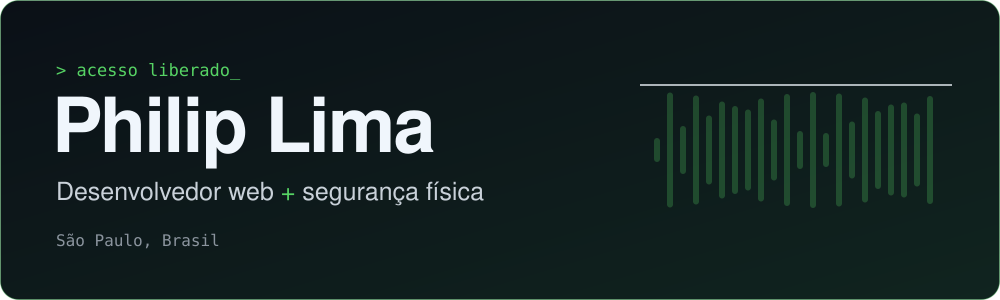
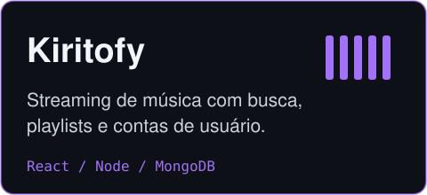
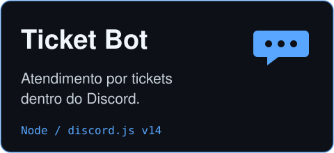
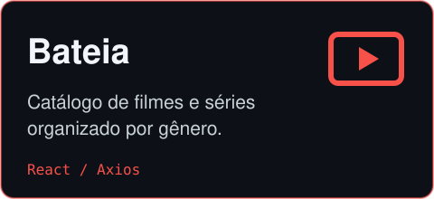
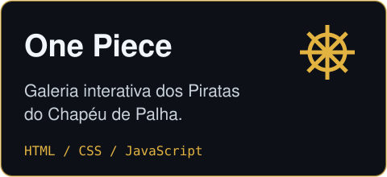

  

  
  
  
  
  

## Oi, eu sou o Philip 👋

De um lado, **segurança física** na Concentrix: controle de acesso, hardware e investigação de incidentes. Do outro, **desenvolvimento web**: player de música, bot para Discord e interfaces em React. Minha base em design vem da SAGA, e estudo Análise e Desenvolvimento de Sistemas na UNINOVE.

## 🚀 Projetos em destaque

  
  
  
  

### 🎧 Kiritofy

Plataforma de streaming de música que roda no navegador. O backend em Express cuida de busca, navegação, áudio, playlists, contas com JWT e foto de perfil, com MongoDB para os dados e cache para as respostas. Baseado no projeto open source kiritofy, de Sahil Chouksey.

[Abrir o player](https://kiritofy.netlify.app/) · [Página do app](https://kiritofydownload.netlify.app/)

### 🎫 Ticket Bot

Bot de suporte para servidores de Discord. O usuário abre um ticket e a equipe assume o atendimento, adiciona ou remove pessoas e fecha a conversa. Usa discord.js v14 e SQLite, com arquivos de idioma separados. É open source sob Apache 2.0.

[Ver o código](https://github.com/philipxlima/ticket-bot) · [Documentação](https://kiritobot.pages.dev/)

### 🎬 Bateia

Catálogo de filmes e séries inspirado na Netflix. Um banner principal e fileiras por gênero (ação, comédia, terror, romance e animação) são montados com dados de API, em componentes React.

[Ver o código](https://github.com/philipxlima/Bateia)

### 🏴‍☠️ One Piece

Galeria dos personagens em HTML, CSS e JavaScript puro: ao escolher um tripulante, a arte, o nome e a história mudam na tela. O layout é responsivo. Feito na Semana do Zero ao Programador Contratado.

[Ver ao vivo](https://philipxlima.github.io/One-Piece/) · [Código](https://github.com/philipxlima/One-Piece)

## 🛠️ Ferramentas

  

| Área | O que uso |
| :-- | :-- |
| **Front-end** | JavaScript, TypeScript, React, HTML, CSS |
| **Back-end** | Node.js, Express, MongoDB, Python, Lua |
| **Design** | Photoshop, Illustrator, Premiere, After Effects, Maya |
| **Segurança física** | Lenel OnGuard, Genetec, Invenzi, Control iD, HID |

## 👾 Minhas contribuições

  

